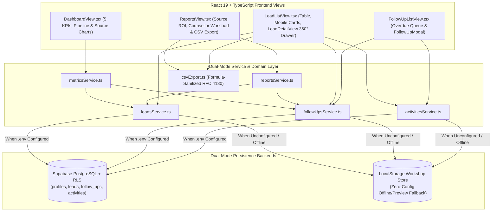

# BrightPath CRM — Student Enquiry, Counselling & Admissions Platform

**BrightPath CRM** is a modern, role-scoped student admissions and lead management web application built for educational academies, coaching institutes, and university admissions teams. It streamlines student enquiry capture, guided pipeline progression (`New` $\rightarrow$ `Contacted` $\rightarrow$ `Qualified` $\rightarrow$ `Converted` / `Lost`), timed follow-up scheduling with overdue alerts, 360° audit timelines, reconciled executive analytics, and formula-sanitized CSV reporting.

---

## 1. Key Capabilities

- **Dual-Mode Persistence Engine**:
  - **Zero-Config Workshop Preview Mode**: Runs out-of-the-box with `npm install && npm run dev` using a rich, pre-seeded local dataset persisted in `localStorage` — **no Supabase account required** to explore, create leads, progress statuses, schedule follow-ups, or export CSVs.
  - **Live Supabase Cloud Mode**: Connects seamlessly to **Supabase PostgreSQL + Auth + Row Level Security (RLS)** as soon as `VITE_SUPABASE_URL` and `VITE_SUPABASE_ANON_KEY` are provided in `.env`.
- **Role-Based Access Control (RBAC)**:
  - **Counsellor (`counsellor`)**: Scoped to their personally assigned student enquiries and follow-ups (plus unassigned pool enquiries).
  - **Admissions Manager (`manager`) & Institute Admin (`admin`)**: Full visibility across all counsellors, team-wide conversion analytics, and lead reassignment controls.
  - Includes an instant **Workshop Role Switcher** bar at the top of the workspace to preview `Counsellor`, `Manager`, and `Admin` perspectives in 1 click.
- **5-Stage Admissions Pipeline & Mandatory Lost Reason Gate**:
  - `New` $\rightarrow$ `Contacted` $\rightarrow$ `Qualified` $\rightarrow$ `Converted` / `Lost`.
  - Transitioning any enquiry to `Lost` triggers a mandatory **Lost Reason Modal** (`LostReasonModal.tsx`) so no student lead is closed without documented feedback.
- **Follow-Up Scheduler & Real-Time Overdue Engine**:
  - Dynamically flags pending follow-ups where `due_at < now()` as **OVERDUE**, surfaces urgent tasks on the Dashboard, and synchronizes the sidebar notification badge.
- **360° Student Lead Detail Drawer & Activity Audit Timeline**:
  - Slide-over drawer with 1-click **Call (`tel:`)**, **WhatsApp (`https://wa.me/`)**, and **Email (`mailto:`)** outreach actions, counselling note logging, and a chronological audit log (`created`, `status_changed`, `followup_added`, `followup_completed`, `note_added`).
- **100% Reconciled Analytics Dashboard & Sanitized CSV Exports**:
  - 5 KPI cards, stacked pipeline distribution bar, channel ROI breakdown, and OWASP formula-sanitized CSV exports (`\uFEFF` UTF-8 BOM for Microsoft Excel & Apple Numbers).

---

## 2. System Architecture & Data Flow



---

## 3. Repository Structure

```text
brightpath-crm/
├── public/                        # Static assets
├── supabase/
│   ├── migrations/
│   │   ├── 001_schema.sql         # PostgreSQL enums, tables, triggers & indexes
│   │   ├── 002_rls_policies.sql   # Row Level Security (RLS) policies per role
│   │   └── 003_demo_seed.sql      # Idempotent demo seed script (14 leads, follow-ups, activities)
│   └── README.md                  # Step-by-step Supabase SQL migration instructions
├── src/
│   ├── components/
│   │   ├── feedback/              # ConfigNotice, ErrorBoundary, ToastContainer
│   │   ├── layout/                # AppLayout, Sidebar, Header, HeaderUserMenu, MobileNav
│   │   └── ui/                    # Button, Badge, Card, StatCard
│   ├── context/                   # AuthContext (Supabase Auth + Workshop Role Preview), ToastContext
│   ├── features/
│   │   ├── activity/              # ActivityTimeline, ActivityItem
│   │   ├── auth/                  # SignInModal (with 1-click Demo Staff Presets)
│   │   ├── dashboard/             # DashboardView, KpiGrid, PipelineChart, RecentLeadsCard
│   │   ├── followups/             # FollowUpListView, FollowUpCard, FollowUpModal
│   │   ├── leads/                 # LeadListView, LeadFilterBar, LeadTable, LeadCardMobile,
│   │   │                          # LeadModal, LeadForm, LeadStatusSelect, LostReasonModal, LeadDetailView
│   │   └── reports/               # ReportsView
│   ├── lib/                       # supabaseClient.ts & environment diagnostics
│   ├── services/                  # leadsService, followUpsService, activitiesService,
│   │                              # metricsService, reportsService
│   ├── types/                     # TypeScript interfaces (auth, leads, followups, navigation)
│   ├── utils/                     # validation.ts, csvExport.ts
│   ├── App.tsx                    # Root view router & global state coordinator
│   ├── main.tsx                   # React root with ErrorBoundary wrapper
│   └── index.css                  # Design system tokens, responsive grid & accessibility rules
├── .env.example                   # Template for VITE_SUPABASE_URL and VITE_SUPABASE_ANON_KEY
├── plan.md                        # Master execution roadmap & phase commit log
├── TEST_CHECKLIST.md              # End-to-end verification & QA test matrix
├── package.json
└── vite.config.ts
```

---

## 4. Quick Start Guide (Works With or Without Supabase)

### Option A: Instant Local Run (Zero-Config Workshop Preview Mode)
If you have not set up a Supabase project yet, you can run and test 100% of BrightPath CRM immediately:

```powershell
# 1. Install dependencies
npm install

# 2. Start the development server
npm run dev
```

Open `http://localhost:5173` in your browser. You can switch between `Counsellor`, `Manager`, and `Admin` using the top **Workshop Role Preview** bar, create and edit leads, test the Lost Reason modal, schedule follow-ups, inspect the 360° drawer, and export CSV files.

---

### Option B: Connecting Your Own Supabase Project (Full Cloud Persistence)

1. **Create a Free Supabase Project**:
   - Visit [https://supabase.com/dashboard](https://supabase.com/dashboard) and create a new project.
2. **Configure `.env`**:
   - Copy `.env.example` to `.env` in the project root:
     ```powershell
     Copy-Item .env.example .env
     ```
   - In your Supabase Dashboard, go to **Project Settings $\rightarrow$ API** and paste your **Project URL** and **anon / public key** into `.env`:
     ```env
     VITE_SUPABASE_URL=https://your-project-ref.supabase.co
     VITE_SUPABASE_ANON_KEY=your-anon-public-key
     ```
3. **Run the 3 SQL Migrations in Order**:
   - Open the **SQL Editor** in your Supabase Dashboard and execute these files sequentially:
     1. [`supabase/migrations/001_schema.sql`](file:///c:/Users/kanha/brightpath-crm/supabase/migrations/001_schema.sql) — Creates `profiles`, `leads`, `follow_ups`, `activities`, triggers, and indexes.
     2. [`supabase/migrations/002_rls_policies.sql`](file:///c:/Users/kanha/brightpath-crm/supabase/migrations/002_rls_policies.sql) — Enables Row Level Security and creates role-scoped policies.
     3. [`supabase/migrations/003_demo_seed.sql`](file:///c:/Users/kanha/brightpath-crm/supabase/migrations/003_demo_seed.sql) — Seeds 14 realistic Indian student enquiries, follow-ups, and audit activities.
4. **Restart the Dev Server**:
   ```powershell
   npm run dev
   ```

---

## 5. Demo Staff Accounts & Role Matrix

Click **Sign In** in the top bar and select any of the **1-Click Demo Staff Presets** (or use the credentials below):

| Staff Member | Role | Email | Password | Access Scope |
| :--- | :--- | :--- | :--- | :--- |
| **Priya Sharma** | `Counsellor` | `priya.brightpath@gmail.com` | `BrightPathDemo2025!` | Personal assigned leads + unassigned pool |
| **Aarav Patel** | `Manager` | `aarav.brightpath@gmail.com` | `BrightPathDemo2025!` | Full institute-wide leads, follow-ups & reports |
| **Dr. Ramesh Verma** | `Admin` | `ramesh.brightpath@gmail.com` | `BrightPathDemo2025!` | Full administrative control across all records |

> **Tip**: In ** Supabase Dashboard $\rightarrow$ Authentication $\rightarrow$ Providers $\rightarrow$ Email**, disable **"Confirm email"** if you want new staff sign-ups to log in immediately without email verification links.

---

## 6. Build, Lint & Verification Commands

```powershell
# Type-check with TypeScript (tsc -b) and build production bundle
npm run build

# Run ESLint static analysis
npm run lint

# Preview the production build locally
npm run preview
```

See [`TEST_CHECKLIST.md`](file:///c:/Users/kanha/brightpath-crm/TEST_CHECKLIST.md) for the complete 27-point end-to-end test matrix.

---

## 7. Troubleshooting

- **"Setup Mode: Supabase environment variables are missing" banner appears**:
  - Either continue using the app in **Workshop Preview Mode** (all features work via `localStorage`), or create a `.env` file with `VITE_SUPABASE_URL` and `VITE_SUPABASE_ANON_KEY` and restart `npm run dev`.
- **"Database Migration Required" banner appears**:
  - Your `.env` keys are connected, but the tables haven't been created yet. Run `001_schema.sql`, `002_rls_policies.sql`, and `003_demo_seed.sql` in your Supabase SQL Editor.
- **Resetting Local Demo Data**:
  - To reset any local changes made in Workshop Preview Mode back to the original seeded state, open Browser DevTools $\rightarrow$ Application $\rightarrow$ Local Storage and clear keys starting with `brightpath_`.
